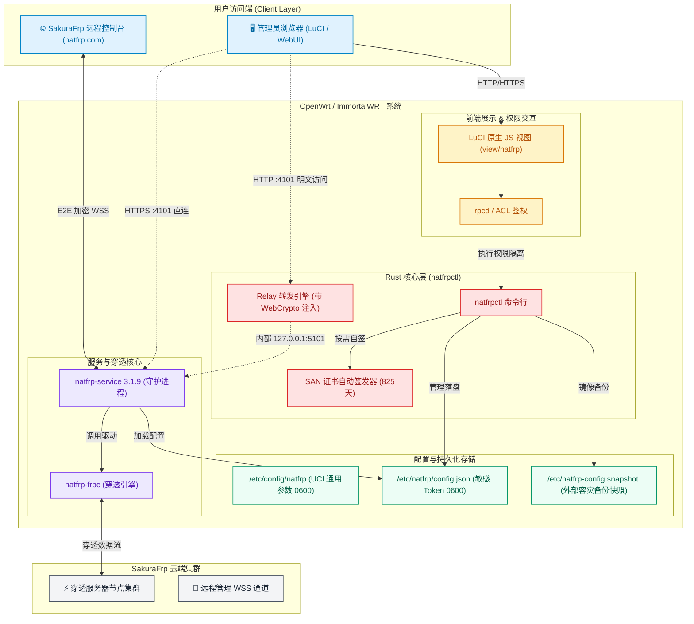
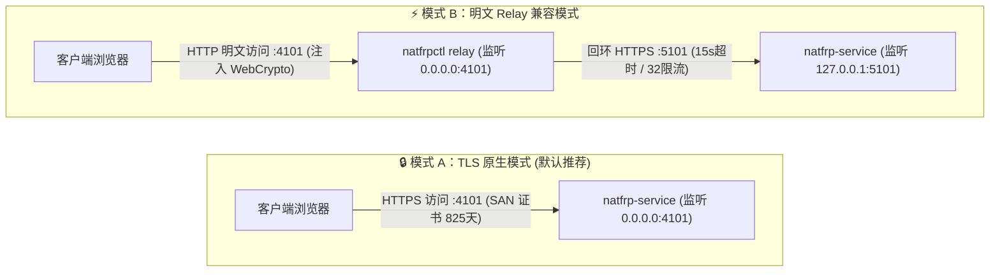

<div align="center">

# 🌸 SakuraFrp for OpenWrt

### 现代化 OpenWrt 原生集成方案 · Rust 高性能后端 + 原生 LuCI JS 响应式界面 + 单包 APK 交付

[](https://github.com/LianXia233/natfrp-openwrt/releases/latest)
[](https://github.com/LianXia233/natfrp-openwrt/releases/latest)
[](https://openwrt.org)
[](#matrix)
[](rust/)
[](https://github.com/LianXia233/natfrp-openwrt/actions/workflows/build-apk.yml)
[](LICENSE)

<br/>

<p align="center">
  <a href="#highlights"><b>核心亮点</b></a> •
  <a href="#matrix"><b>版本兼容</b></a> •
  <a href="#architecture"><b>架构解析</b></a> •
  <a href="#quickstart"><b>安装指引</b></a> •
  <a href="#config"><b>配置与命令</b></a> •
  <a href="#security"><b>安全架构</b></a> •
  <a href="#troubleshooting"><b>排障诊断</b></a> •
  <a href="https://github.com/LianXia233/natfrp-openwrt/releases/latest"><b>下载最新 APK</b></a>
</p>

</div>

---

## 📖 项目简介 <a id="overview"></a>

**SakuraFrp for OpenWrt (`luci-app-natfrp`)** 是为新一代 OpenWrt（25.12+ / ImmortalWRT SNAPSHOT APK 架构）打造的全新 **[SakuraFrp (natfrp)](https://www.natfrp.com)** 启动器深度集成方案。

本项目重塑了传统路由器内网穿透插件的开发体验：
- **摒弃臃肿依赖**：彻底移除对遗留 Lua 脚本与 `luci-compat` 兼容层的依赖，采用**原生 LuCI JS** 构建响应式现代交互界面。
- **自研高性能 Rust 后端 (`natfrpctl`)**：以极小资源开销实现配置同步、安全加固、SAN 证书自签与明文 Relay 反向代理。
- **企业级安全防御**：敏感密钥全生命周期隔离保护，拒绝明文落盘 UCI；独家配置镜像快照机制，保障固件升级与配置零丢失。

> [!NOTE]
> 守护进程与 `frpc` 核心基于官方 3.1.9 经过严谨 sha256 校验的稳定构建版本。本项目专注于系统集成、配置生命周期、安全隔离、前后端协同与现代 APK 交付。

---

## 🌟 核心亮点 <a id="highlights"></a>

<table>
  <tr>
    <td width="50%">
      <h3>⚡ 自研 Rust 高性能后端 (natfrpctl)</h3>
      <p>采用官方 Rust 工具链交叉编译生成极简静态二进制。专职负责精准合并配置、生成 825 天 SAN 现代自签证书、维护 Relay 转发桥接与状态白名单汇报，零冗余运行时依赖。</p>
    </td>
    <td width="50%">
      <h3>🎨 原生纯血 LuCI JS 响应式界面</h3>
      <p>原生对接 OpenWrt <code>menu.d</code> 与 <code>rpcd/acl.d</code> 权限体系。支持深色/浅色自适应主题与移动端适配，提供实时运行指示灯、连接口令一键复制与控制台直达入口。</p>
    </td>
  </tr>
  <tr>
    <td width="50%">
      <h3>🛡️ 纵深安全防御机制</h3>
      <p>用户访问密钥（Token）<b>绝不落盘 UCI</b>，由 Rust 核心直接写往 0600 隔离配置，避免只读访客越权嗅探；随机密码采用拒绝采样算法，彻底消除模偏差。</p>
    </td>
    <td width="50%">
      <h3>🔄 双轨容灾，配置永不丢失</h3>
      <p>构建独立于配置目录之外的 <code>/etc/natfrp-config.snapshot</code> 系统级快照，配合 <code>.bak</code> 故障自愈机制。即使升级换包、误删目录或配置解析异常，均可秒级无感自愈。</p>
    </td>
  </tr>
  <tr>
    <td width="50%">
      <h3>🔀 双模穿透，网络无缝兼容</h3>
      <p>支持<b>原生 TLS (HTTPS)</b> 与<b>明文 Relay (HTTP)</b> 自由切换。明文模式下通过 Rust 注入 WebCrypto 兼容垫片并实施 15s 超时与 32 并发防雪崩保护，兼顾安全与兼容。</p>
    </td>
    <td width="50%">
      <h3>📦 现代单包 APK 交付</h3>
      <p>专为 OpenWrt 25.12+ 全新 <code>apk</code> 体系定制。守护进程、<code>frpc</code>、<code>natfrpctl</code>、LuCI 资源与系统服务统一归一于单个 APK，开箱即用，卸载干净。</p>
    </td>
  </tr>
</table>

---

## 🏗️ 架构与运行机制 <a id="architecture"></a>

### 系统分层架构



### 两种 WebUI 访问模式对比



---

## 📋 版本与兼容性矩阵 <a id="matrix"></a>

### 组件版本清单

| 组件名称 | 版本 | 来源与构建方式 | 作用与职责 |
|---|---|---|---|
| **`luci-app-natfrp`** | **`3.2.1-r1`** | 本仓库 CI 自动化流水线构建 | 单包 APK 交付封装，涵盖所有运行组件 |
| **`natfrpctl`** | **`1.1.0`** | 本仓库 Rust 源码静态编译 | 配置管理、证书签发、明文 Relay、状态探测 |
| **`natfrp-service`** | **`3.1.9`** | 官方 CDN（严格锁定 sha256） | SakuraFrp 核心守护进程 |
| **`natfrp-frpc`** | **`0.51.0-sakura-15.1`** | 官方 CDN（严格锁定 sha256） | 底层 FRP 协议穿透通信核心 |
| **LuCI 界面** | 原生 JS | 本仓库前端源码 | 无依赖、无 Lua 兼容层的响应式页面 |

### 硬件与运行环境要求

| 判定维度 | 规格要求 | 说明与备注 |
|---|---|---|
| **包管理器** | **`apk`** | 专为 OpenWrt 25.12+ 及 ImmortalWRT SNAPSHOT APK 设计 |
| **支持架构** | **`aarch64_cortex-a53`** | 实机验证于 `mediatek/filogic` 平台（如 MT7981 / MT7986 / MT7988） |
| **系统运行时依赖** | `luci-base`、`openssl-util` | `openssl-util` 负责本地证书生成与明文 Relay 管道 |
| **ROM 存储占用** | 约 **36 MiB** | 包含全部预编译二进制、前端资源与管理工具 |

> [!NOTE]
> `natfrpctl` 编译目标固定为 `aarch64-unknown-linux-musl`。若需其他 CPU 架构（如 x86_64、mips 等），可参考本地构建章节调整目标平台参数重新打包。

---

## 🚀 快速开始 <a id="quickstart"></a>

### 1. 下载与安装

前往 [GitHub Releases](https://github.com/LianXia233/natfrp-openwrt/releases/latest) 下载最新版本的 APK 安装包，或在路由器终端执行以下命令：

```sh
# 下载最新 APK (请替换或使用对应版本链接)
wget https://github.com/LianXia233/natfrp-openwrt/releases/download/latest/luci-app-natfrp-3.2.1-r1.apk

# 执行安装 (由于是本地/CI 构建包，必须附带 --allow-untrusted 参数)
apk add --allow-untrusted ./luci-app-natfrp-3.2.1-r1.apk
```

> [!TIP]
> **安装后验证**：
> ```sh
> # 确认包已正确安装
> apk info -v | grep natfrp
>
> # 验证 Rust 控制后端版本
> natfrpctl version
> # 正常输出示例: {"ok":true,"version":"1.1.0"}
> ```

---

### 2. 首次使用向导

打开 OpenWrt Web 界面，导航至 **服务 (Services) → SakuraFrp 内网穿透**：

```
┌────────────────────────────────────────────────────────────────────────┐
│  ● 服务运行中   natfrp-service 3.1.9 (frpc 0.51.0-sakura-15.1)          │
│  [打开 WebUI]   [打开远程管理]   [下载证书]   [复制口令: ******]       │
└────────────────────────────────────────────────────────────────────────┘
```

1. **配置访问密钥**：勾选「启用服务」，填入从 [SakuraFrp 访问密钥管理页](https://www.natfrp.com/user/accesskeys) 获取的 Token，点击「保存并应用」。
2. **WebUI 与安全口令**：
   - 默认启用 WebUI（`0.0.0.0:4101`，HTTPS 模式）。
   - 首次启用时系统会自动从 `/dev/urandom` 生成 20 位高强度连接口令。
   - 页面顶部提供便捷的 **「复制连接口令」** 与 **「下载证书」** 按钮。
3. **远程管理 (可选)**：
   - 勾选「启用远程管理」后，可一键直达 [SakuraFrp 远程管理平台](https://www.natfrp.com/remote/v2)。
   - E2E 密码留空将由系统自动派生。
4. **隧道启动**：
   - 在「自动启动的隧道 ID」填入隧道编号（多个以逗号隔开），保存后即刻自动建立内网穿透连接。

---

## ⚙️ 配置与命令清单 <a id="config"></a>

### UCI 配置参数对照 (`/etc/config/natfrp`)

所有用户可读写参数集中于 `/etc/config/natfrp`：

| 配置项 | 类型 | 默认值 | 详细说明 |
|---|:---:|:---:|---|
| `enabled` | `bool` | `0` | 是否开机自启；保存时实时拉起或停止服务 |
| `token` | `string` | — | 访问密钥（**不写入 UCI**，由后台安全存入 `config.json`） |
| `webui` | `bool` | `1` | 是否启用启动器自带的 WebUI 控制界面 |
| `webui_tls` | `bool` | `1` | `1` 为原生 HTTPS 访问；`0` 为回环 HTTPS + 明文 Relay 访问 |
| `webui_host` | `ip` | `0.0.0.0` | WebUI 监听地址（Relay 模式下即为明文入口地址） |
| `webui_port` | `port` | `4101` | WebUI 监听端口；关闭 TLS 时端口必须 **> 1000** |
| `webui_pass` | `string` | 自动生成 | WebUI 连接口令；留空时首次生成，后续留空保持不变 |
| `remote_mgmt` | `bool` | `0` | 是否开启出站 WSS 远程管理 |
| `remote_mgmt_pass` | `string` | 自动生成 | 远程管理 E2E 口令；经过 PBKDF2 派生后存储哈希值 |
| `remote_allow_config` | `bool` | `0` | 是否允许通过云端远程控制台修改路由器本地配置（默认关闭防风险） |
| `remote_allow_update` | `bool` | `0` | 是否允许通过云端远程控制台触发更新（默认关闭） |
| `auto_start_tunnels` | `string` | — | 随服务启动自动运行的隧道 ID 清单（以逗号或空格分隔） |
| `check_update` | `bool` | `0` | 是否开启每周定期检查启动器更新（避免频繁写 Flash，默认关闭） |

---

### Rust 后端 CLI 指令集 (`natfrpctl`)

`natfrpctl` 提供了完善的底层操控与诊断指令：

```text
用法: natfrpctl <子命令> [参数...]
```

| 子命令 | 参数与示例 | 权限要求 | 用途描述 |
|---|---|:---:|---|
| `status` | `natfrpctl status` | 只读权限 | 输出服务运行状态、进程 PID、版本、监听端口（**不泄露任何明文口令**） |
| `version` | `natfrpctl version` | 只读权限 | 返回当前 `natfrpctl` 后端版本信息（JSON 格式） |
| `secrets` | `natfrpctl secrets` | root / 写权限 | 读取当前的 WebUI 密码与远程管理明文密码（供前端页面渲染） |
| `set-token` | `natfrpctl set-token <TOKEN>`<br/>`natfrpctl set-token --clear` | root / 写权限 | 安全写入或清除访问密钥至隔离配置 `config.json` |
| `apply` | `natfrpctl apply [--restart]` | root / 写权限 | 同步 UCI 设置到启动器配置；`--restart` 强制触发进程重载 |
| `restore` | `natfrpctl restore` | root | 当配置损坏或丢失时，从 `/etc/natfrp-config.snapshot` 恢复配置 |
| `render` | `natfrpctl render` | root | 根据当前配置生成并格式化 `config.json`（开机服务脚本专用） |
| `relay` | `natfrpctl relay` | root | 启动明文 HTTP 入口并桥接至内部 HTTPS（仅在关闭 TLS 时调用） |
| `webui-cert` | `natfrpctl webui-cert` | root / 写权限 | 输出当前 WebUI 证书的 PEM 文本内容（供前端一键导出） |

---

## 🔒 运行时与安全架构设计 <a id="security"></a>

### 端口映射与隔离

| 模式设置 (`webui_tls`) | 守护进程监听 (Daemon) | 对外暴露服务入口 | 流量说明 |
|:---:|---|---|---|
| **`1` (TLS 模式)** | `webui_host:webui_port`<br/>*(默认 `0.0.0.0:4101`)* | 原生 HTTPS 端口直连 | 走自签 SAN 证书，全链路加密传输 |
| **`0` (Relay 模式)** | `127.0.0.1:(webui_port+1000)`<br/>*(如 `127.0.0.1:5101`)* | `natfrpctl relay`<br/>*(监听 `webui_host:webui_port`)* | 外部明文 HTTP 访问，经由本地 Relay 终止并桥接至回环 HTTPS |

#### 验证网络监听命令

```sh
# 查看端口监听
netstat -ltnp | grep -E ':(4101|5101) '

# 验证本地守护进程连通性 (TLS / Relay 模式均可测试回环)
curl -sk https://127.0.0.1:5101/ -o /dev/null -w 'HTTP Code: %{http_code}\n'

# 验证外部 Relay 入口连通性 (仅 Relay 模式)
curl -s http://192.168.1.1:4101/ -o /dev/null -w 'HTTP Code: %{http_code}\n'
```

---

### 文件系统布局与权限隔离

本项目遵循最小权限原则（PoLP），关键凭据与持久化目录严格限制权限：

```text
/
├── etc/
│   ├── config/
│   │   └── natfrp                      # [0600] UCI 配置文件 (绝对不存 Token/明文密码)
│   ├── natfrp/                         # [0700] 启动器核心数据隔离区
│   │   ├── config.json                 # [0600] 守护进程配置 (含 Token 与 WebUI 密钥)
│   │   ├── config.json.bak             # [0600] 上一次可用配置的故障冗余备份
│   │   ├── remote_pass                 # [0600] 远程管理明文密码 (用于页面端展示)
│   │   ├── webui.crt                   # [0644] 自动生成的 SAN 证书文件 (825天有效期)
│   │   ├── webui.key                   # [0600] 证书私钥
│   │   └── FrpcWorkingDirectory/       # [0755] frpc 运行时临时工作目录
│   └── natfrp-config.snapshot          # [0600] 独立于 /etc/natfrp 之外的灾备快照镜像
└── usr/
    └── bin/
        ├── natfrpctl                   # [0755] Rust 控制后端
        └── natfrpctl-status            # [0755] 面向只读用户的受限白名单调用脚本
```

> [!IMPORTANT]
> - **日志无闪存损耗**：守护进程日志默认统一路由至系统 `syslog`，不执行磁盘写盘。实时日志排查直接执行：`logread | grep -i natfrp`。
> - **Procd 进程看门狗**：服务全程由 OpenWrt `procd` 守护，异常崩溃将毫秒级自拉起，兼具防重启风暴机制。

---

## 🔄 升级、迁移与卸载 <a id="upgrade"></a>

### 同系列平滑升级

```sh
# 升级现有 APK
apk add --allow-untrusted --upgrade ./luci-app-natfrp-<新版本>.apk

# 重启并使配置生效
natfrpctl apply --restart
```

> [!NOTE]
> `apk` 升级默认只触发 `pre/post-upgrade` 钩子。每次修改配置时系统均会自动同步最新快照至 `/etc/natfrp-config.snapshot`，升级过程配置零丢失。若升级后页面未刷新，可清理 LuCI 缓存：
> ```sh
> rm -f /tmp/luci-indexcache.* && /etc/init.d/rpcd restart
> ```

---

### 从官方 3.1.9 旧插件迁移

若之前使用的是官方旧版单架构包（如 `aarch64_generic`），由于包名架构重叠，卸载旧包时其脚本可能会清空 `/etc/natfrp`，**迁移前务必执行备份**：

```sh
# 1. 备份现有配置
cp /etc/natfrp/config.json /root/natfrp-config.backup

# 2. 卸载旧版
apk del luci-app-natfrp

# 3. 安装本项目现代版
apk add --allow-untrusted ./luci-app-natfrp-*.apk

# 4. 还原配置并修复权限
mkdir -p /etc/natfrp && cp /root/natfrp-config.backup /etc/natfrp/config.json
chmod 600 /etc/natfrp/config.json

# 5. 重启服务
/etc/init.d/natfrp restart
```

---

### 彻底卸载与环境清理

卸载时系统默认保留 `/etc/natfrp` 与配置快照以防误删凭据。如需彻底清除：

```sh
# 卸载软件包
apk del luci-app-natfrp

# 彻底清理配置文件与容灾快照
rm -rf /etc/natfrp /etc/natfrp-config.snapshot /etc/config/natfrp
```

---

## 🛠️ 排障诊断指南 <a id="troubleshooting"></a>

<details open>
<summary><b>🔍 常见问题速查表 (点击折叠 / 展开)</b></summary>

<br/>

| 异常现象 | 诱因分析 | 推荐排查与解决步骤 |
|---|---|---|
| **LuCI 界面未出现菜单项** | LuCI 页面索引缓存未刷新 | 执行 `rm -f /tmp/luci-indexcache.* && /etc/init.d/rpcd restart`，重新登录后台 |
| **页面报错「配置文件读取失败」** | 配置文件意外损坏或 JSON 格式异常 | **切勿删除备份文件**；执行 `natfrpctl restore` 自动从快照恢复，或检查 `/etc/natfrp/config.json.bak` |
| **导入证书后浏览器仍报不受信任** | 访问 IP 与证书 SAN 不匹配或系统根证书未完全信任 | 1. 确保使用局域网 IP 访问；<br/>2. Windows 需将证书导入至「受信任的根证书颁发机构」；<br/>3. iOS 需在「关于本机 → 证书信任设置」中开启完全信任 |
| **关闭 TLS 后 WebUI 无法访问** | 端口冲突或缺少 `openssl-util` | 1. 确认系统已安装 `openssl-util`；<br/>2. 确认 `webui_port > 1000`；<br/>3. `netstat -ltnp \| grep :4101` 检查 Relay 是否就绪 |
| **服务无法启动 / 自动停止** | Token 错误或穿透服务异常退出 | 查看实时系统日志：`logread \| grep -i natfrp` 或运行 `/etc/init.d/natfrp status` |
| **遗失 WebUI 登录口令** | 忘记自动生成的随机密码 | 使用终端以 root 身份执行 `natfrpctl secrets` 查看口令，或在 LuCI 页面留空重新生成 |

</details>

---

## ⚠️ 已知限制 <a id="limitations"></a>

- **WebUI 内嵌隧道编辑受限**：启动器自带 WebUI 的「新建/编辑隧道」功能内嵌了官方页面 `https://www.natfrp.com/_launcher/create-tunnel`。由于上游设置的 HTTP `frame-ancestors` 响应头仅允许 `'self'` 与 `https://launcher.natfrp.com`，局域网直接以 IP 访问时会被现代浏览器的安全策略拦截。建议直接在 [SakuraFrp 控制台](https://www.natfrp.com) 或通过远程管理页管理和修改隧道。
- **远程管理认证方式**：当前远程管理通过基于 nonce 的加密挑战认证；上游虽支持 TOTP 二次验证，但目前本包 LuCI 页面暂未引入 TOTP 输入界面。
- **目标架构与发行计划**：当前官方 CI 发布构建固定面向 `aarch64_cortex-a53`；其他架构（如 x86_64、mips32 等）需自行调整 SDK 目标与 blob 后重新打包。
- **明文 Relay 性能开销**：当选择关闭 TLS 开启明文 Relay 时，底层采用每连接调用 `openssl s_client` 终止回环加密。虽已内置 32 并发连接上限与 15 秒超时保护，但在极端低算力设备上高频请求仍会有一定 CPU 开销，日常推荐使用原生 TLS 模式。
- **上游二进制黑盒**：官方守护进程及 `frpc` 均为闭源静态二进制，本仓库未做任何逆向或字节级改写，仅按 SHA-256 完整性约束引入。

---

## 🛡️ 深度安全说明 <a id="security-deep"></a>

- **敏感密钥物理隔离**：访问密钥 Token 与 WebUI 连接密码仅写往 `/etc/natfrp/config.json`（权限 `0600`，属主 root），远程管理密码仅留存于 `/etc/natfrp/remote_pass`（`0600`）。任何只读权限的普通 LuCI 账号均无法通过 uci 查看明文。
- **短暂进程命令行暴露**：执行 `set-token` 与 `remote-kdf` 时，参数会通过 CLI 传递，在毫秒级执行瞬间可能在 `/proc/<pid>/cmdline` 中留下瞬态痕迹。路由器为单用户嵌入式场景时无安全影响，多用户共享系统请知悉。
- **上游 KDF 特性防范**：远程管理密钥在官方协议中使用 `PBKDF2-HMAC-SHA256`（固定 Salt + 10,000 次迭代），计算代价相对较低。为此本项目将「允许远程修改配置」与「允许远程触发更新」**默认置为关闭**；强烈建议配置长且复杂的强口令并定期更换。
- **WebUI 访问 Token 泄露防御**：启动器 Web 控制通道会将 `webui_pass` 携带在 URL 查询参数中。请务必在 TLS 加密连接下或完全可信的局域网内访问，避免在公网反代明文链路中暴露。
- **供应链固化校验**：所有从官方 CDN 拉取的外部预编译二进制均在 CI 中按 SHA-256 逐项校验（见 `scripts/vendor-sha256.txt`），严防 CDN 劫持或上游构建被污染。

---

## 🏗️ 源码构建与开发 <a id="build"></a>

### CI 自动化构建流水线 (`.github/workflows/build-apk.yml`)

每次代码推送均会触发 GitHub Actions 严苛的自动化流水线：
1. **Node LTS 环境检测**：执行 `node --check` 语法静态扫描与 `scripts/test-inject.js` 兼容层单元测试（含 61 组 WebCrypto 测试向量）。
2. **Rust 官方工具链**：执行 `cargo fmt --check` 格式审查、`cargo test` 单元测试，并通过 `aarch64-unknown-linux-musl` 交叉编译全静态二进制。
3. **上游供应链校验**：从官方 CDN 拉取二进制，逐一比对 `scripts/vendor-sha256.txt` 固化哈希。
4. **OpenWrt 官方 SDK 打包**：通过 OpenWrt 官方 Snapshot SDK 构建标准 APK 包并发布 Release。

### 本地快速调试与二次开发

```sh
# 1. 本地交叉编译 (需具备 Linux / WSL 环境与 Rust musl target)
ARCH=aarch64 ./scripts/build.sh

# 2. 快速部署到测试路由器实机进行热调试
HOST=root@192.168.1.1 ./scripts/deploy.sh
```

---

## 📂 仓库目录结构 <a id="structure"></a>

```text
├── .github/
│   └── workflows/
│       └── build-apk.yml            # GitHub Actions 自动化 CI 构建与发版工作流
├── rust/                            # natfrpctl 纯 Rust 后端源码 (纯标准库实现，零膨胀)
│   ├── Cargo.toml                   # Rust 项目清单
│   ├── main.rs                      # 核心 CLI 子命令调度、配置渲染、证书生成与主控逻辑
│   ├── config.rs                    # config.json 安全读写、.bak 容灾与系统快照镜像机制
│   ├── relay.rs                     # 明文 HTTP Relay 反向代理引擎 (含连接池与超时防护)
│   ├── inject.js                    # 注入至明文页面的 WebCrypto 兼容垫片
│   ├── json.rs                      # 轻量高效的纯手写 JSON 解析器
│   └── sh.rs                        # 安全无泄漏的进程派生与 UCI 执行封装
├── src/
│   └── luci-app-natfrp/             # 单包 APK 交付目录
│       ├── Makefile                 # OpenWrt SDK 包构建定义与安装流控制
│       ├── htdocs/.../view/natfrp/  # LuCI 原生 JS 交互视图 (纯前端响应式实现)
│       └── root/                    # 系统根配置挂载 (uci、init.d、menu.d、rpcd/acl.d)
├── scripts/                         # 本地编译、调试、测试向量与哈希清单
│   ├── build.sh                     # 本地交叉编译辅助脚本
│   ├── deploy.sh                    # 路由器设备直推免打包热调试脚本
│   ├── test-inject.js               # WebCrypto 垫片 61 组算法测试套件
│   └── vendor-sha256.txt            # 官方守护进程与 frpc 二进制 SHA-256 钉死基线
├── CHANGELOG.md                     # 详细版本迭代更新日志
├── LICENSE                          # 许可证文件
└── README.md                        # 项目主文档
```

---

## 📜 许可协议与鸣谢 <a id="license"></a>

- 本项目代码采用 **[MIT License](LICENSE)** 协议开源。
- 本项目集成与分发的 SakuraFrp 守护进程及 `frpc` 归属于 [SakuraFrp (natfrp.com)](https://www.natfrp.com) 官方所有，遵循其分发许可（AGPL-3.0）。
- 特别鸣谢 [SakuraFrp](https://www.natfrp.com) 团队为国内网络穿透领域提供的卓越基础设施与服务支持。

<div align="center">

**🌸 享受极速、稳定、现代化的 OpenWrt 内网穿透之旅 🌸**

</div>
